# OpenGameArt: textures

**32 assets from [OpenGameArt](https://opengameart.org), dedicated to the public domain under [CC0](https://creativecommons.org/publicdomain/zero/1.0/).** Use them in any game, free or paid, and change them however you like; no credit is needed.

Textures from OpenGameArt entries licensed CC0 (some also offer other licences; CC0 is the one that applies here). 814.4 MB in all.

This is a copy kept by [zuujis-cc0](https://github.com/zuujis-cc0) so game makers can take single files from GitHub. It is not made by or affiliated with OpenGameArt: the originals, often in more formats and higher resolutions, are on [opengameart.org](https://opengameart.org). If they help you, consider [supporting OpenGameArt](https://opengameart.org/content/faq).

Every file is listed in [MANIFEST.tsv](MANIFEST.tsv) with its size and SHA-256. More free assets: [the Zuujis collection](https://github.com/zuujis-cc0/free-game-assets#readme).

| | | | |
| :-: | :-: | :-: | :-: |
| <a href="2-seamless-grass-textures">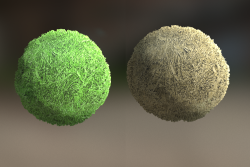</a> <b><a href="2-seamless-grass-textures">2 Seamless Grass Textures</a></b> by StarNinjas · <a href="https://opengameart.org/content/2-seamless-grass-textures">source</a> | <a href="300-gradient-textures">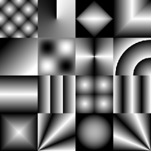</a> <b><a href="300-gradient-textures">300+ Gradient Textures</a></b> by Screaming Brain Studios · <a href="https://opengameart.org/content/300-gradient-textures">source</a> | <a href="4-seam-less-brick-textures">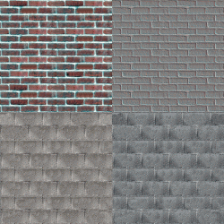</a> <b><a href="4-seam-less-brick-textures">4 seam-less brick textures</a></b> by GrEmlin · <a href="https://opengameart.org/content/4-seam-less-brick-textures">source</a> | <a href="photorealistic-texture-pack-2">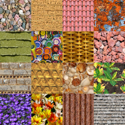</a> <b><a href="photorealistic-texture-pack-2">Photorealistic Texture Pack 2</a></b> by Screaming Brain Studios · <a href="https://opengameart.org/content/photorealistic-texture-pack-2">source</a> |
| <a href="planet-surface-textures">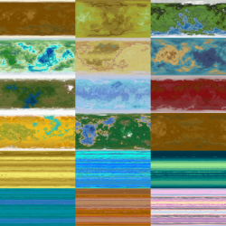</a> <b><a href="planet-surface-textures">Planet Surface Textures</a></b> by Screaming Brain Studios · <a href="https://opengameart.org/content/planet-surface-textures">source</a> | <a href="prototype-textures-32px">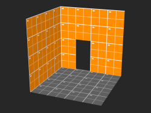</a> <b><a href="prototype-textures-32px">Prototype Textures (32px)</a></b> by Emerald Eel Entertainment · <a href="https://opengameart.org/content/prototype-textures-32px">source</a> | <a href="psx-paper-textures-32x32px">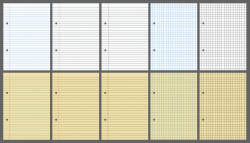</a> <b><a href="psx-paper-textures-32x32px">PSX Paper Textures (32x32px)</a></b> by Emerald Eel Entertainment · <a href="https://opengameart.org/content/psx-paper-textures-32x32px">source</a> | <a href="pumpkin-skins">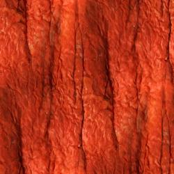</a> <b><a href="pumpkin-skins">Pumpkin skins</a></b> by cron · <a href="https://opengameart.org/content/pumpkin-skins">source</a> |
| <a href="resistor-normal-map">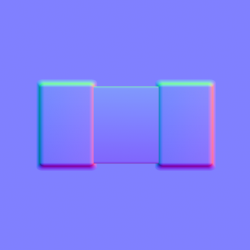</a> <b><a href="resistor-normal-map">Resistor normal map</a></b> by wikiti · <a href="https://opengameart.org/content/resistor-normal-map">source</a> | <a href="rpg-stone-wall-texture">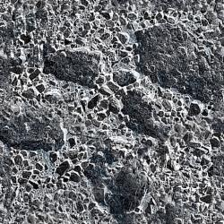</a> <b><a href="rpg-stone-wall-texture">RPG Stone Wall Texture</a></b> by ForKotLow · <a href="https://opengameart.org/content/rpg-stone-wall-texture">source</a> | <a href="seamless-cartoon-textures">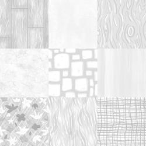</a> <b><a href="seamless-cartoon-textures">Seamless Cartoon Textures</a></b> by OzMaister · <a href="https://opengameart.org/content/seamless-cartoon-textures">source</a> | <a href="seamless-sky-backgrounds">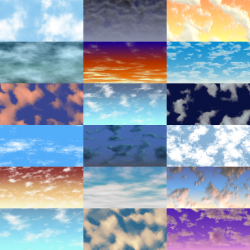</a> <b><a href="seamless-sky-backgrounds">Seamless Sky Backgrounds</a></b> by Screaming Brain Studios · <a href="https://opengameart.org/content/seamless-sky-backgrounds">source</a> |
| <a href="ship-port">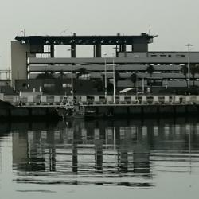</a> <b><a href="ship-port">Ship port</a></b> by gonzalofdz · <a href="https://opengameart.org/content/ship-port">source</a> | <a href="simple-textures">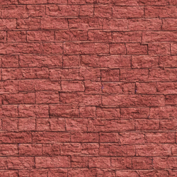</a> <b><a href="simple-textures">Simple Textures</a></b> by oceancucumber · <a href="https://opengameart.org/content/simple-textures">source</a> | <a href="stamped-metal-normal-map">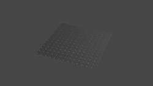</a> <b><a href="stamped-metal-normal-map">Stamped Metal Normal Map</a></b> by hansonry · <a href="https://opengameart.org/content/stamped-metal-normal-map">source</a> | <a href="stone-tiles-0">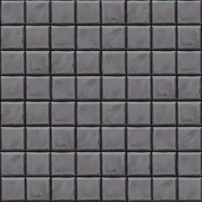</a> <b><a href="stone-tiles-0">Stone tiles</a></b> by Kutejnikov · <a href="https://opengameart.org/content/stone-tiles-0">source</a> |
| <a href="surface-pack">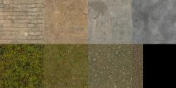</a> <b><a href="surface-pack">Surface pack</a></b> by prolific · <a href="https://opengameart.org/content/surface-pack">source</a> | <a href="tiny-texture-pack-3">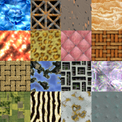</a> <b><a href="tiny-texture-pack-3">Tiny Texture Pack 3</a></b> by Screaming Brain Studios · <a href="https://opengameart.org/content/tiny-texture-pack-3">source</a> | <a href="tomatoes-16x-minecraft-style">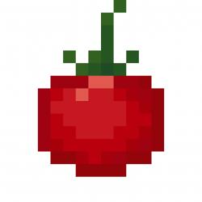</a> <b><a href="tomatoes-16x-minecraft-style">Tomatoes 16x Minecraft Style</a></b> by JoeEnderman · <a href="https://opengameart.org/content/tomatoes-16x-minecraft-style">source</a> | <a href="too-many-stones-just-the-assets-16x-minecraft-style">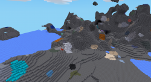</a> <b><a href="too-many-stones-just-the-assets-16x-minecraft-style">Too Many Stones just the assets 16x Minecraft style</a></b> by JoeEnderman · <a href="https://opengameart.org/content/too-many-stones-just-the-assets-16x-minecraft-style">source</a> |
|  <b><a href="trashy-pixel-art-grass">Trashy Pixel Art Grass</a></b> by RadRobinRetro · <a href="https://opengameart.org/content/trashy-pixel-art-grass">source</a> | <a href="tree-leaves-pack-1">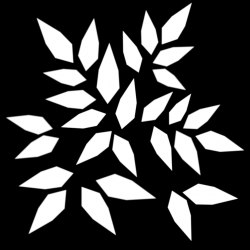</a> <b><a href="tree-leaves-pack-1">Tree Leaves Pack 1</a></b> by TrachinusDraco · <a href="https://opengameart.org/content/tree-leaves-pack-1">source</a> | <a href="trimsheet-set-1">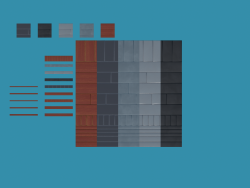</a> <b><a href="trimsheet-set-1">Trimsheet set 1</a></b> by loafbrr_1 · <a href="https://opengameart.org/content/trimsheet-set-1">source</a> |  <b><a href="truss-imprint-textures">Truss Imprint Textures</a></b> by YCbCr · <a href="https://opengameart.org/content/truss-imprint-textures">source</a> |
|  <b><a href="turnip-16x-minecraft-style">Turnip 16x Minecraft style</a></b> by JoeEnderman · <a href="https://opengameart.org/content/turnip-16x-minecraft-style">source</a> | <a href="ugly-64x64-texturesprites-pack">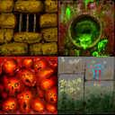</a> <b><a href="ugly-64x64-texturesprites-pack">ugly 64x64 texture+sprites pack</a></b> by Popiz · <a href="https://opengameart.org/content/ugly-64x64-texturesprites-pack">source</a> | <a href="various-normal-map-patterns">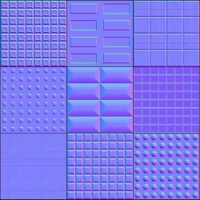</a> <b><a href="various-normal-map-patterns">Various Normal Map Patterns</a></b> by YCbCr · <a href="https://opengameart.org/content/various-normal-map-patterns">source</a> | <a href="volcanic-lava">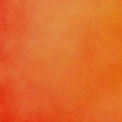</a> <b><a href="volcanic-lava">Volcanic lava</a></b> by gonzalofdz · <a href="https://opengameart.org/content/volcanic-lava">source</a> |
| <a href="wall-texture-1">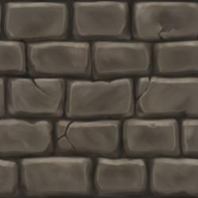</a> <b><a href="wall-texture-1">Wall texture</a></b> by Kutejnikov · <a href="https://opengameart.org/content/wall-texture-1">source</a> |  <b><a href="yellowshirta-macredhead-minetest-edition">Yellowshirt(a) M(a)cRedhead: Minetest Edition</a></b> by frosty ham · <a href="https://opengameart.org/content/yellowshirta-macredhead-minetest-edition">source</a> | <a href="zortch-unused-textures">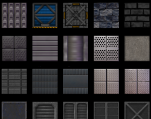</a> <b><a href="zortch-unused-textures">Zortch Unused Textures</a></b> by mutantleg · <a href="https://opengameart.org/content/zortch-unused-textures">source</a> | <a href="zortch-unused-textures-2">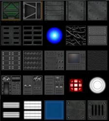</a> <b><a href="zortch-unused-textures-2">Zortch Unused Textures 2</a></b> by mutantleg · <a href="https://opengameart.org/content/zortch-unused-textures-2">source</a> |

---

Kept up to date by this repository's own [update workflow](.github/workflows/update.yml), with code and plan from [cc0-mirror](https://github.com/zuujis-cc0/cc0-mirror). Something wrong? [Open an issue there](https://github.com/zuujis-cc0/cc0-mirror/issues/new) or use the [private report form](https://games.zuujis.com/report).
